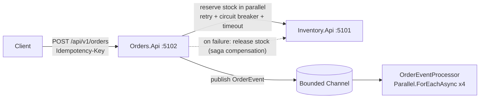

# OrderFlow


A hands-on **.NET 8** portfolio project that demonstrates the concurrency, API and microservice skills backend teams look for:
**threads / `Task` / `async`-`await`**, **REST APIs**, **custom middleware**, and **resilient service-to-service communication**.

> Two small microservices (**Orders** and **Inventory**) talking over HTTP, a shared library of reusable middleware and resilience handlers,
> a **ConcurrencyLab** console app with runnable demos of classic concurrency problems, and unit tests for the tricky parts.



## What this project demonstrates

| Topic | Where to look | What it shows |
|---|---|---|
| Threads vs `Task` vs ThreadPool | `ConcurrencyLab` → `threads` | What each one is, and that a `Task` is a promise, not a thread |
| Sync vs async vs parallel | `ConcurrencyLab` → `async` | Why async scales I/O and `Parallel` speeds up CPU work |
| Race conditions | `ConcurrencyLab` → `races` | `counter++` vs `lock` vs `Interlocked`; `GetOrAdd` factory pitfall |
| Throttling | `ConcurrencyLab` → `throttle` | `SemaphoreSlim`, `Parallel.ForEachAsync(MaxDegreeOfParallelism)` |
| Cancellation & timeouts | `ConcurrencyLab` → `cancel` | Linked tokens, `WaitAsync` caveat |
| Producer/consumer + backpressure | `ConcurrencyLab` → `channels`, `Orders.Api/Events.cs` | Bounded `Channel<T>` and a `BackgroundService` consumer |
| Deadlock & thread-pool starvation | `ConcurrencyLab` → `deadlock`, `starvation` | Reproduces `.Wait()` deadlock and low-CPU/high-latency starvation |
| Lock-free inventory | `Inventory.Api/Models.cs` | CAS loop with `Interlocked.CompareExchange` - no oversell |
| Idempotent endpoints | `Orders.Api/IdempotencyStore.cs` | `ConcurrentDictionary<string, Lazy<Task<T>>>`, payload fingerprinting |
| Saga / compensation | `Orders.Api/OrdersService.cs` | Parallel reservations, release on partial failure |
| Custom middleware | `OrderFlow.Shared/Middleware` | Correlation ID, timing, global exception → `ProblemDetails`, API-key auth |
| Resilience | `OrderFlow.Shared/Resilience` | Retry + jitter, circuit breaker, per-attempt timeout as `DelegatingHandler`s |
| Rate limiting | `Orders.Api/Program.cs` | Built-in fixed-window (global) + token-bucket (per endpoint) |
| REST design | `Orders.Api/Program.cs` | Versioned routes, `201 + Location`, paging, `409`/`400`/`429`, idempotent `DELETE` |
| Fault injection | `Inventory.Api/Chaos.cs` | Runtime failure/latency injection to watch the resilience layer work |
| Testing | `tests/` | Concurrency tests, circuit-breaker state machine with a fake clock, saga & idempotency tests |

## Getting started

Prerequisite: [.NET 8 SDK](https://dotnet.microsoft.com/download).

```bash
dotnet build
dotnet test
```

### Run the concurrency demos

```bash
dotnet run --project src/ConcurrencyLab               # everything (roughly 20-30 s)
dotnet run --project src/ConcurrencyLab -- deadlock   # a single demo
dotnet run --project src/ConcurrencyLab -- help       # lists the demo names
```

### Run the microservices

```bash
# terminal 1
dotnet run --project src/Inventory.Api     # http://localhost:5101

# terminal 2
dotnet run --project src/Orders.Api        # http://localhost:5102  (Swagger at /swagger in Development)
```

Then open [`requests.http`](requests.http) (VS Code *REST Client*, Rider or Visual Studio) and try the numbered requests, or use Docker:

```bash
docker compose up --build
```

### Try the resilience layer

1. Create a few orders - everything works.
2. Make Inventory flaky: `POST http://localhost:5101/admin/chaos?failureRate=0.7&latencyMs=300` (header `X-Api-Key: dev-secret-key-change-me`).
3. Create more orders and watch Orders' logs: **retries with backoff → circuit opens → fast `503`s**.
4. `GET http://localhost:5102/api/v1/diagnostics` shows the circuit state.
5. Heal it (`failureRate=0`) and watch the circuit go **half-open → closed** after 15 s.

## Design decisions (and the trade-offs)

- **In-memory storage.** Keeps the focus on concurrency and architecture. The repository interface makes swapping in EF Core + SQL Server a local change.
- **Hand-rolled resilience instead of Polly / `Microsoft.Extensions.Http.Resilience`.** Deliberate: the project is meant to *show how the patterns work*. In production I would use the library.
- **Retries only on idempotent operations.** Reservations are keyed by `(orderId, sku)`, so a retried request can't double-deduct stock.
- **Idempotency work ignores the first caller's `CancellationToken`.** If the client disconnects mid-saga, we still want to finish or compensate cleanly. The trade-off is a request that can't be aborted by its caller.
- **`OrdersService` is scoped, state is in singletons.** A singleton that captures a typed `HttpClient` would never pick up DNS changes.
- **Compensation can fail too.** Today it is logged for reconciliation; the production answer is the **outbox pattern**.

## Known limitations / next steps

- [ ] Replace in-memory stores with EF Core + SQL Server (optimistic concurrency with `rowversion`)
- [ ] Idempotency keys need a TTL / persistent store (they currently live for the process lifetime)
- [ ] Transactional outbox + a real broker (Azure Service Bus / RabbitMQ) instead of the in-process channel
- [ ] API gateway (YARP) in front of both services
- [ ] OpenTelemetry traces + metrics, exported to Jaeger / Application Insights
- [ ] JWT auth for the public API (the API key is service-to-service only)
- [ ] Drain the event channel on graceful shutdown

## Project layout

```
src/
  ConcurrencyLab/     console app: 9 runnable concurrency demos
  OrderFlow.Shared/   middleware (correlation, timing, exceptions, API key) + resilience handlers
  Inventory.Api/      stock service: lock-free reservations, idempotent, fault injection
  Orders.Api/         order service: saga, idempotency, rate limiting, background worker
tests/                xUnit tests for each component
docs/                 INTERVIEW_QA.md, STUDY_PLAN.md
```

## Interview prep

[`docs/INTERVIEW_QA.md`](docs/INTERVIEW_QA.md) maps every concept above to interview questions with model answers and
"how I solved it" stories. [`docs/STUDY_PLAN.md`](docs/STUDY_PLAN.md) is a day-by-day plan for working through the repo.

## License

MIT
