# ConcurrencyLab

A small .NET 8 console app with **9 runnable demos** of classic C# concurrency problems.
Each demo answers one common interview question. You can **run it, watch what happens, and explain it**.

Every line the lab prints shows which thread printed it, so you can see when work changes threads:

```
  [T  8 pool] Task<int> result = 42 ...
   │  │   └── "pool" = ThreadPool thread, "own " = a thread we created ourselves
   │  └────── managed thread id
   └───────── printed by Out.Line(...)
```

---

## Contents

- [How to run](#how-to-run)
- [Project structure](#project-structure)
- [How the app works](#how-the-app-works)
- Demos
  1. [`threads`: Thread vs ThreadPool vs Task](#1-threads--thread-vs-threadpool-vs-task)
  2. [`async`: Sync vs async vs concurrent vs parallel](#2-async--sync-vs-async-vs-concurrent-vs-parallel)
  3. [`races`: Race conditions, lock, Interlocked, GetOrAdd](#3-races--race-conditions-lock-interlocked-getoradd)
  4. [`throttle`: SemaphoreSlim and Parallel.ForEachAsync](#4-throttle--semaphoreslim-and-parallelforeachasync)
  5. [`cancel`: CancellationToken, linked tokens, WaitAsync](#5-cancel--cancellationtoken-linked-tokens-waitasync)
  6. [`channels`: Producer/consumer with backpressure](#6-channels--producerconsumer-with-backpressure)
  7. [`deadlock`: The sync-over-async deadlock](#7-deadlock--the-sync-over-async-deadlock)
  8. [`exceptions`: Task.WhenAll and exceptions](#8-exceptions--taskwhenall-and-exceptions)
  9. [`starvation`: Thread-pool starvation](#9-starvation--thread-pool-starvation)
- [Cheat sheet](#cheat-sheet)

---

## How to run

From the repository root:

```bash
dotnet run --project src/ConcurrencyLab                       # run all demos (~25-30 s)
dotnet run --project src/ConcurrencyLab -- all                # same thing
dotnet run --project src/ConcurrencyLab -- races              # run one demo
dotnet run --project src/ConcurrencyLab -- deadlock channels  # run several, in this order
dotnet run --project src/ConcurrencyLab -- help               # unknown name -> prints the list of demos
```

> Timings and thread ids **will differ** on your machine and between runs. That is expected:
> scheduling is non-deterministic. The **pattern** is what matters.
> The sample outputs below were captured on a 12-core machine running .NET 8.

---

## Project structure

| File | What it is |
|---|---|
| [Program.cs](Program.cs) | Entry point. Holds the list of demos, reads command-line arguments and runs the chosen demos one after another. |
| [Demos.cs](Demos.cs) | All 9 demos. Each one is a single `public static` method plus small private helpers. |
| [Out.cs](Out.cs) | `Out.Line(...)`: writes a console line prefixed with the current thread id and whether it is a pool thread. |
| [SingleThreadSyncContext.cs](SingleThreadSyncContext.cs) | A home-made single-threaded `SynchronizationContext` that behaves like a WPF/WinForms UI thread. Used only by the `deadlock` demo. |

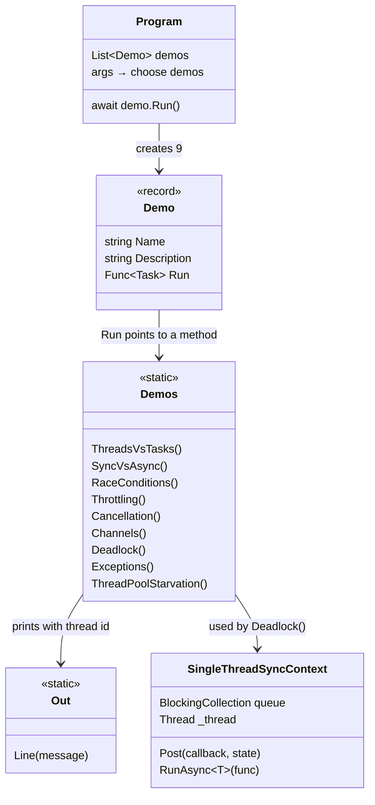

---

## How the app works

[Program.cs](Program.cs) uses top-level statements:

1. It builds a `List<Demo>`. `Demo` is a record of `(Name, Description, Func<Task> Run)`, and `Run` points to a method in `Demos`.
2. It picks the demos to run:
   - no arguments, or `all`: every demo
   - otherwise: every demo whose name appears in `args` (case-insensitive)
3. If nothing matched, it prints usage and returns exit code `1`.
4. It prints the CPU count and runtime version, then **awaits each demo one after another**, so the output of one demo never mixes with the next.

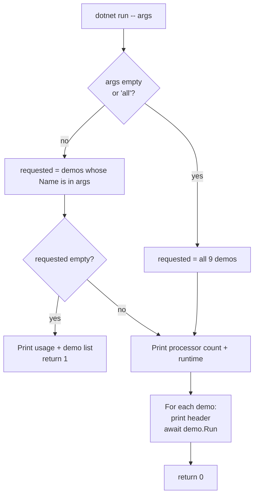

---

## 1. `threads`: Thread vs ThreadPool vs Task

> **Interview question:** *"What is the difference between a Thread and a Task?"*

### What the code does

| Step | Code | What it shows |
|---|---|---|
| 1 | `new Thread(...).Start(); Join()` | A **dedicated OS thread**. You create it, it gets its own ~1 MB stack, you must manage it. It prints `own`. |
| 2 | `ThreadPool.QueueUserWorkItem(...)` | Runs on a **reused pool thread**. It is cheap, but it gives you no handle, no result and no exception propagation. A `TaskCompletionSource` is needed just to know when it finished. |
| 3 | `await Task.Run(...)` | Also runs on the pool, but returns a **`Task`** you can `await`, which carries completion and exceptions. |
| 4 | `await Task.Run(() => 42)` | `Task<int>`: a **promise of a future result**. |
| 5 | `Task.Delay(300)` | A Task that is **just a timer**. No thread runs or waits while it is pending. |
| 6 | after `await` | The method continues on **a different thread**, because console apps have no `SynchronizationContext`. |

### Diagram

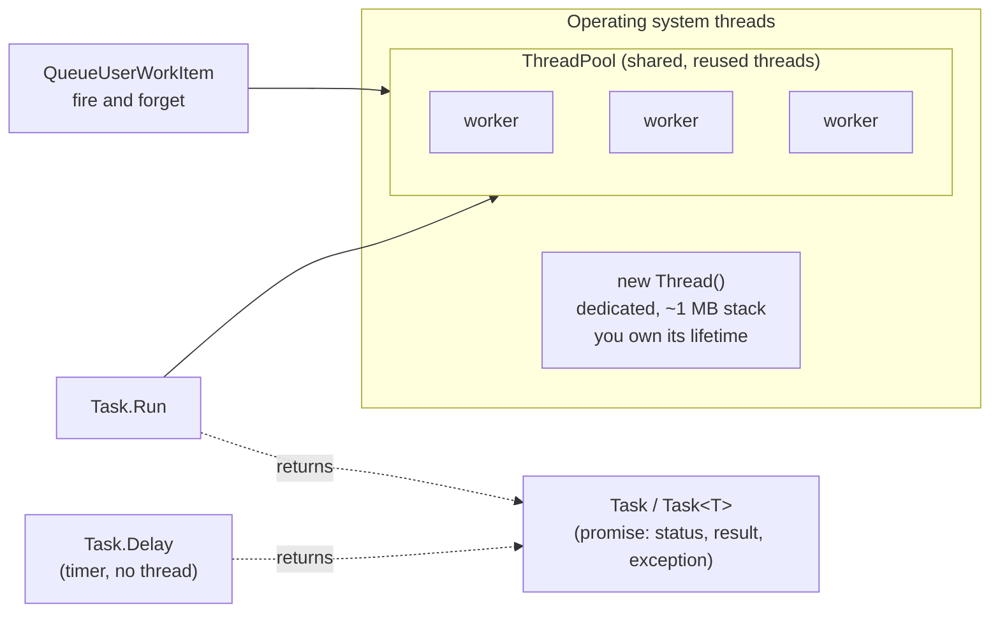

A `Task` is **not** a thread. It is an object that represents work that will finish later.
Some tasks run code on a pool thread (`Task.Run`). Others use **no thread at all** while pending (`Task.Delay`, network I/O, file I/O).

### Sample output

```
  [T  1 own ] Main flow starts
  [T  4 own ] Dedicated Thread: I created it, I own it, ~1MB stack, I must manage it
  [T  5 pool] ThreadPool work item: a reused, pooled thread - cheap, but no result/exception/continuation support
  [T  7 pool] Task.Run: runs on the pool AND gives me an awaitable handle, result and exception flow
  [T  8 pool] Task<int> result = 42. A Task is a PROMISE of a future result - not a thread.
  [T  8 pool] Task.Delay(300) is just a timer: IsCompleted=False, and NO thread is blocked while it waits.
  [T  8 pool] After await we may be on a different thread (console apps have no SynchronizationContext).
```

Look at the thread ids: the method starts on `T1 own` (the main thread) and finishes on `T8 pool`. Each `await` may resume on any pool thread.

### Answer in one line

> A **Thread** is an OS resource you manage yourself. A **Task** is a promise of a result, usually scheduled on the ThreadPool, which you can await, compose, cancel and get exceptions from. Use Tasks; create a raw Thread only when you really need a dedicated long-running thread.

---

## 2. `async`: Sync vs async vs concurrent vs parallel

> **Interview question:** *"Does async make my code faster?"*

### What the code does

The same "fake I/O call" that takes 500 ms is run 5 times, in 4 different ways:

| Variant | Code | Thread behaviour |
|---|---|---|
| Sync sequential | `Thread.Sleep(500)` × 5 | One thread **blocked** for 2.5 s |
| Async sequential | `await Task.Delay(500)` × 5 | Still 2.5 s, but the thread is **free** during each wait |
| Async concurrent | `Task.WhenAll(5 × Task.Delay(500))` | All 5 waits **overlap**, so ~0.5 s and still no threads blocked |
| Parallel | `Parallel.For(0, 5, Thread.Sleep(500))` | Also ~0.5 s, but **5 threads are blocked** doing nothing |

### Diagram

```mermaid
gantt
    title 5 calls of 500 ms each
    dateFormat x
    axisFormat %L ms

    section Sync sequential (thread blocked)
    call 1 :0, 500
    call 2 :500, 1000
    call 3 :1000, 1500
    call 4 :1500, 2000
    call 5 :2000, 2500

    section Async sequential (thread free)
    call 1 :0, 500
    call 2 :500, 1000
    call 3 :1000, 1500
    call 4 :1500, 2000
    call 5 :2000, 2500

    section Async concurrent (WhenAll)
    calls 1-5 overlap :0, 500

    section Parallel.For (5 threads blocked)
    calls 1-5 on 5 threads :0, 500
```

### Sample output

```
  [T  8 pool] Sync sequential      :  2527 ms  (thread BLOCKED for every call)
  [T  8 pool] Async sequential     :  2568 ms  (same time, but the thread is FREE while waiting)
  [T  8 pool] Async concurrent     :   516 ms  (calls overlap: ~ the slowest one, not the sum)
  [T  8 pool] Parallel.For + sleep :   530 ms  (also overlaps, but burns 5 threads doing nothing)
```

### Key points

- **async alone does not make one call faster.** Async sequential takes the same time as sync.
- What async gives you is **scalability**: while waiting, the thread can serve other requests.
- **Concurrency** (starting several operations, then `await Task.WhenAll`) is what makes the total time shorter.
- **Parallel** (`Parallel.For`, `PLINQ`) is meant for **CPU-bound** work. Using it for I/O wastes threads.

| Work type | Use |
|---|---|
| I/O-bound (HTTP, DB, files) | `async`/`await`, with `Task.WhenAll` for overlap |
| CPU-bound (math, image processing) | `Parallel.For`/`ForEach`, PLINQ, `Task.Run` |

---

## 3. `races`: Race conditions, lock, Interlocked, GetOrAdd

> **Interview question:** *"How do you make a counter / cache thread-safe?"*

### Part A: the counter

8 tasks each increment a shared counter 100,000 times. The expected total is **800,000**.

#### Why `counter++` loses updates

`counter++` is **not one operation**. It is three: *read*, *add 1*, *write back*. Two threads can interleave like this:

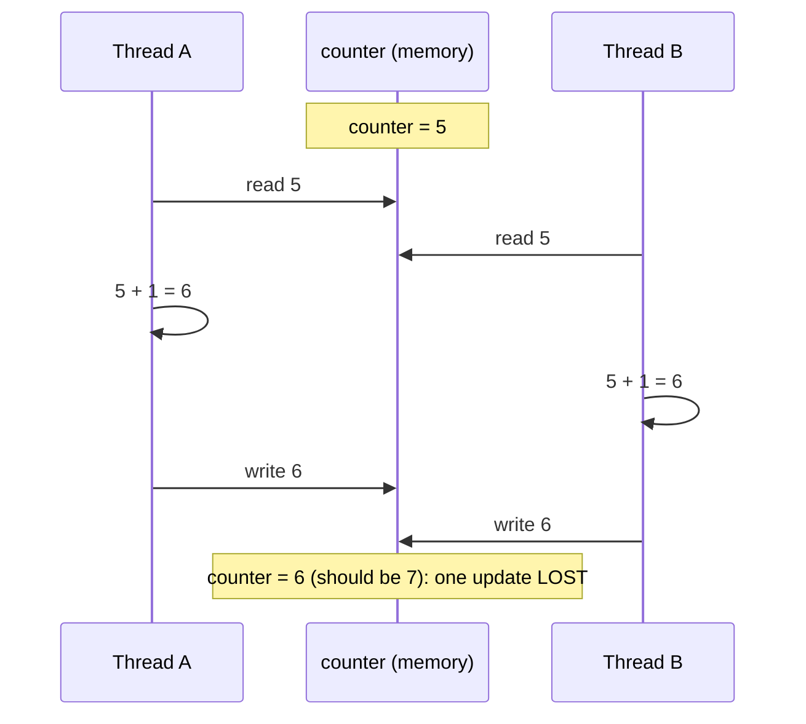

#### The three versions

| Version | Code | Result | Why |
|---|---|---|---|
| Unsafe | `unsafeCounter++` | **wrong** (lost updates) | read-modify-write interleaves |
| Lock | `lock (gate) { lockCounter++; }` | correct | only one thread at a time enters the block; others wait in line |
| Interlocked | `Interlocked.Increment(ref c)` | correct, fastest | a single atomic CPU instruction, no lock needed |

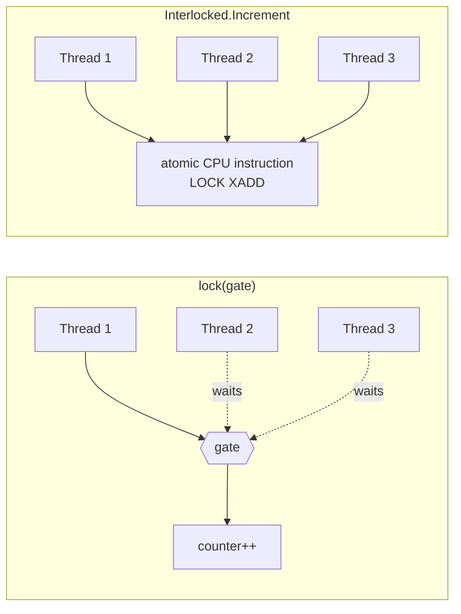

### Part B: `ConcurrentDictionary.GetOrAdd` and its factory

`ConcurrentDictionary` is thread-safe, but **`GetOrAdd(key, factory)` can call the factory more than once** when several threads ask for the same missing key at the same time. Only one result is stored and the others are thrown away. If the factory is expensive or has side effects (an HTTP call, a DB insert, charging a card), that is a bug.

The fix is to store a `Lazy<T>` instead of the value:

```csharp
map.GetOrAdd("key", _ => new Lazy<int>(() => ExpensiveWork())).Value;
```

Creating extra `Lazy` objects is cheap. Only the one stored `Lazy` ever has `.Value` called, so the expensive work runs **exactly once**.

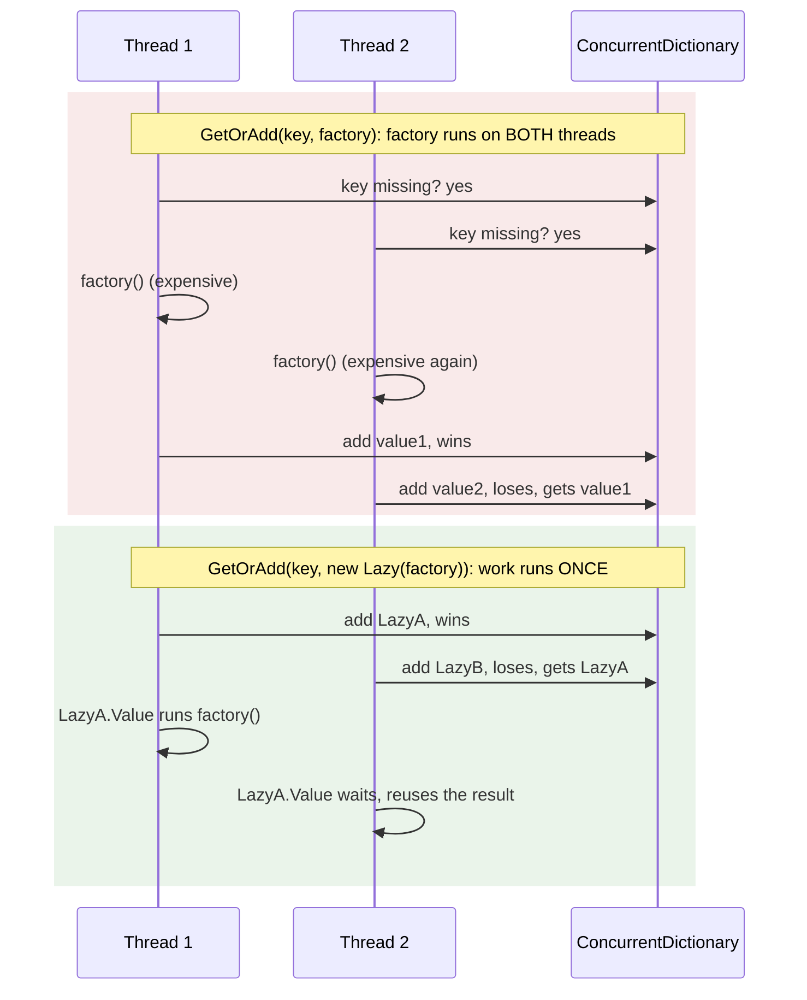

This is the same pattern used in [Orders.Api/IdempotencyStore.cs](../Orders.Api/IdempotencyStore.cs) (`ConcurrentDictionary<string, Lazy<Task<Order>>>`), so a repeated request with the same idempotency key never creates two orders.

### Sample output

```
  [T 17 pool] counter++            :   119783 (expected 800000) -> lost updates: 680217
  [T  5 pool] lock                 :   800000 (correct, but threads queue up on the lock)
  [T 17 pool] Interlocked.Increment:   800000 (correct, lock-free, fastest for a single variable)
  [T 11 pool] GetOrAdd(factory)    : factory ran 12 time(s) for ONE key (only one result is kept)
  [T 18 pool] GetOrAdd + Lazy      : factory ran 1 time(s)  <- the pattern used in Orders.Api IdempotencyStore
```

---

## 4. `throttle`: SemaphoreSlim and Parallel.ForEachAsync

> **Interview question:** *"You must call an API for 10,000 items, but it allows only 5 parallel calls. How?"*

### Option A: `SemaphoreSlim`

A semaphore is a counter of **free slots**. `WaitAsync()` takes a slot (or waits asynchronously until one is free). `Release()` gives the slot back.

```csharp
await gate.WaitAsync();
try   { /* at most N tasks are in here */ }
finally { gate.Release(); }   // ALWAYS release in finally, or slots leak and the app eventually hangs
```

- `lock` **cannot** be used across an `await` (the compiler forbids it). `SemaphoreSlim.WaitAsync` is the async-friendly alternative.
- `SemaphoreSlim(1)` works as an **async mutex**.

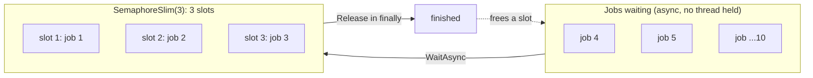

The demo also tracks the **peak** concurrency. `InterlockedMax` is a lock-free "compare-and-swap" loop: it keeps trying to replace `max` with the new value until no other thread changed it in between.

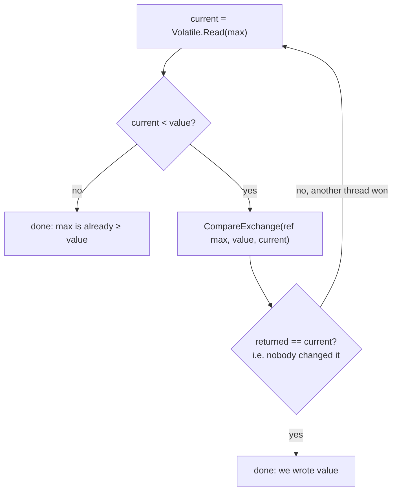

### Option B: `Parallel.ForEachAsync`

The shortest way to throttle async work (.NET 6+):

```csharp
await Parallel.ForEachAsync(items,
    new ParallelOptions { MaxDegreeOfParallelism = 4 },
    async (item, ct) => await CallApiAsync(item, ct));
```

`ParallelOptions` configures the loop:

| Property | Meaning |
|---|---|
| `MaxDegreeOfParallelism` | Maximum number of items processed at the same time (here **4**). |
| `CancellationToken` | Stops the loop. The same token is passed to your body as `ct`. |
| `TaskScheduler` | Where the work is scheduled (rarely changed). |

### Sample output

```
  [T 18 pool] job  1 started   (running now: 1)
  [T 18 pool] job  2 started   (running now: 2)
  [T 18 pool] job  3 started   (running now: 3)
  [T  7 pool] job  6 started   (running now: 3)
  ...
  [T 12 pool] SemaphoreSlim(3): max concurrent = 3
  [T 16 pool] Parallel.ForEachAsync(MaxDegreeOfParallelism=4): peak concurrent = 4
```

"Running now" **never goes above 3**, and jobs 4-10 start only as earlier jobs release their slot.
Note that jobs don't necessarily start in order (6 before 4). A semaphore does **not** guarantee FIFO order.

---

## 5. `cancel`: CancellationToken, linked tokens, WaitAsync

> **Interview question:** *"How do you cancel a long-running operation? What happens to the work after a timeout?"*

The demo uses `LongOperationAsync`: 20 steps × 100 ms = 2 s. At each step it checks the token:

```csharp
ct.ThrowIfCancellationRequested();   // stop between steps
await Task.Delay(100, ct);           // stop in the middle of a wait too
```

Cancellation in .NET is **cooperative**: nothing gets killed. The operation must check the token itself and stop by throwing `OperationCanceledException`.

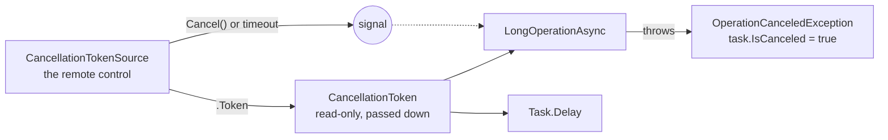

### The three scenarios

**1) Timeout with a token:** `new CancellationTokenSource(700ms)` cancels itself after 700 ms. The operation sees it and stops.

**2) Linked tokens:** "cancel if the user cancels **OR** a safety timeout expires":

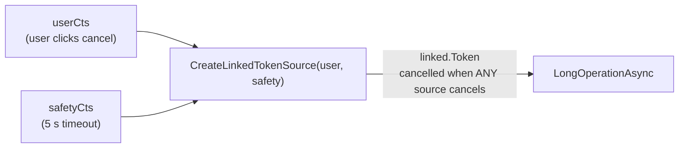

In ASP.NET Core this is common: you link `HttpContext.RequestAborted` with your own timeout.

**3) `WaitAsync(timeout)` stops *waiting*, not the work.**

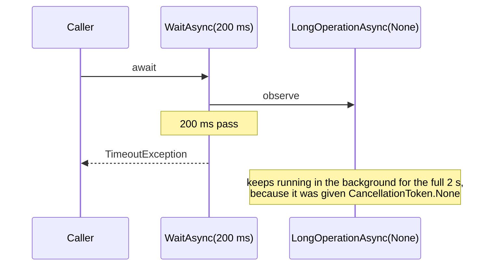

### Sample output

```
  [T 16 pool] 1) Cancelled by timeout - cooperative: the operation checked the token and stopped itself.
  [T  7 pool] 2) Linked token (user OR timeout): task.IsCanceled = True
  [T 16 pool] 3) WaitAsync(timeout) stopped WAITING - but the underlying work keeps running. Pass a token to actually stop it.
```

### Rules of thumb

- Accept a `CancellationToken ct` parameter in every async method and **pass it down** to every call.
- Always `Dispose` a `CancellationTokenSource` (the demo uses `using`), because it may own a timer.
- Catch `OperationCanceledException`. This also catches `TaskCanceledException`, which derives from it.

---

## 6. `channels`: Producer/consumer with backpressure

> **Interview question:** *"How do you decouple a fast producer from a slow consumer without running out of memory?"*

### What the code does

- `Channel.CreateBounded<int>(capacity: 3, FullMode = Wait)`: a thread-safe async queue that holds **at most 3** items.
- **1 producer** writes 1..10 as fast as it can with `await WriteAsync(i)`.
- **2 consumers** read with `await foreach (… ReadAllAsync())` and take 150 ms per item (slow).
- When the buffer is full, `WriteAsync` **waits** (asynchronously). This is **backpressure**: the slow consumer sets the producer's speed.
- `Writer.Complete()` tells the consumers that no more items are coming, so their `await foreach` loops end.

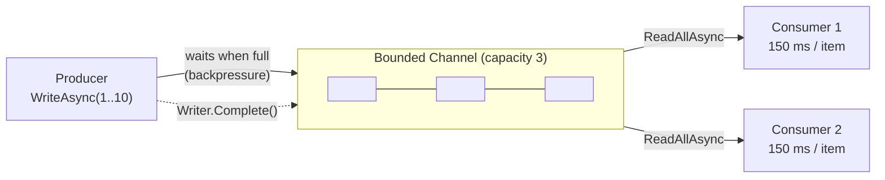

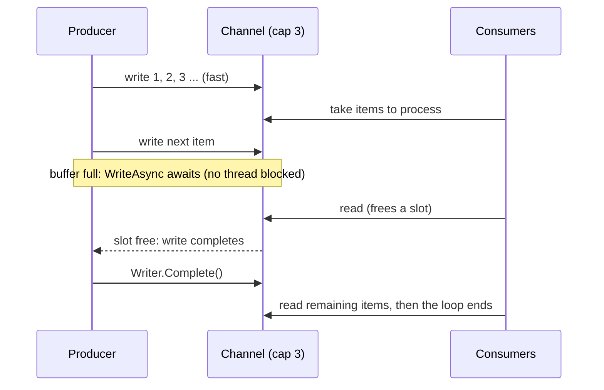

### Sample output (shortened)

```
  [T 12 pool] produced 1
  [T 12 pool] produced 2
  [T 12 pool] produced 3
  [T 12 pool] produced 4
  [T 12 pool] produced 5
  [T  7 pool]     consumer 1 handled 1
  [T 11 pool]     consumer 2 handled 2
  [T  7 pool]     consumer 2 handled 3
  [T 12 pool] produced 6
  [T 11 pool]     consumer 1 handled 4
  [T 12 pool] produced 7
  ...
```

The first ~5 items go out at once (3 in the buffer plus 2 already taken by the consumers). After that, "produced" lines appear **only as fast as consumers free up slots**. That is backpressure working.

Why `.ToList()` on the consumers? `Select(...)` is lazy. Without `ToList()`, enumerating the sequence again (as `consumers.Append(producer)` does) would **start new consumers** each time.

The same idea is used in [Orders.Api/Events.cs](../Orders.Api/Events.cs) with a `BackgroundService` as the consumer.

| Unbounded queue | Bounded channel |
|---|---|
| A fast producer fills memory until the app crashes | The producer slows down to match the consumers |
| No signal that the system is overloaded | Waiting on write *is* the overload signal |

`FullMode` options: `Wait` (backpressure), `DropOldest`, `DropNewest`, `DropWrite` (for when losing data is acceptable, such as telemetry).

---

## 7. `deadlock`: The sync-over-async deadlock

> **Interview question:** *"Why does `.Result` / `.Wait()` deadlock?"*

### The setup: `SingleThreadSyncContext`

Console apps and ASP.NET Core have **no** `SynchronizationContext`, so this deadlock would not happen there by default.
To reproduce it safely, [SingleThreadSyncContext.cs](SingleThreadSyncContext.cs) builds one that works like a UI thread:

- One dedicated thread (`"UI-like thread"`) loops over a `BlockingCollection` queue.
- `Post(callback)` adds work to the queue, and the thread runs queued callbacks **one at a time**.
- The thread installs itself as the current context, so any `await` on it will **post its continuation back to this same thread**.
- `RunAsync(func)` posts `func` to the thread (like a button-click handler) and returns a `Task` with the result.

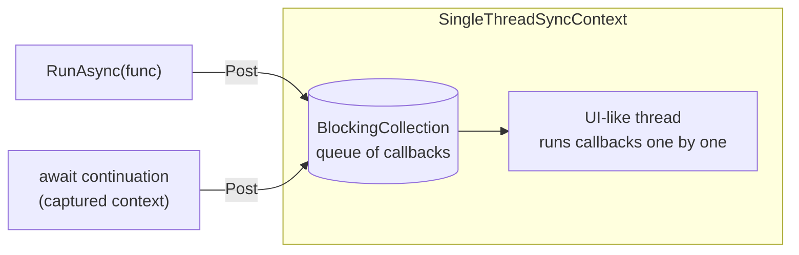

### Why it deadlocks

The "button click" calls `WorkAsync().Wait()`:

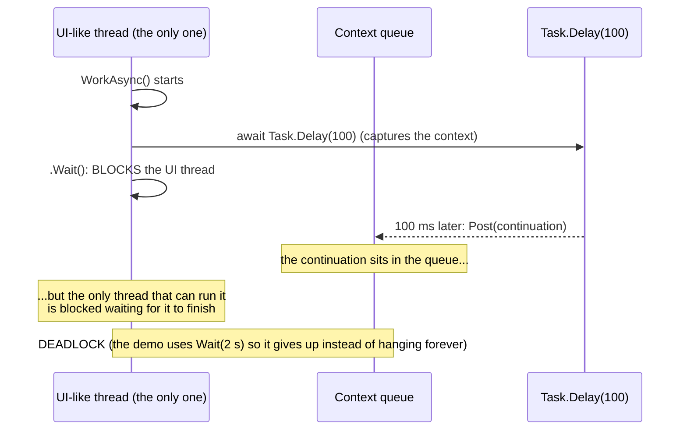

**Each side is waiting for the other:** `.Wait()` waits for the task to finish, and the task needs the blocked thread to finish.

### Fix 1: `ConfigureAwait(false)`

```csharp
await Task.Delay(100).ConfigureAwait(false);
```

This says "I don't need to come back to the captured context". The continuation runs on a **pool thread**, the task completes and `.Wait()` returns. It works, but every `await` in the whole call chain needs it, which is fragile.

### Fix 2 (best): don't block

```csharp
await WorkAsync();   // async all the way up
```

### Sample output

```
  [T 12 pool] BAD   : DEADLOCK. Wait() blocks the only thread; the continuation needs that same thread to resume.
  [T 12 pool] FIX 1 : ConfigureAwait(false) - continuation doesn't need the blocked thread, so it completes.
  [T 12 pool] FIX 2 (best): never block - go async all the way: 'await WorkAsync()'. ...
```

Small detail: `RunAsync` creates its `TaskCompletionSource` with `RunContinuationsAsynchronously`. That way the demo's own `await` continues on the pool instead of running inline on the UI-like thread. This is why these lines show `pool`.

---

## 8. `exceptions`: Task.WhenAll and exceptions

> **Interview question:** *"Three tasks fail. How many exceptions do you see after `await Task.WhenAll`?"*

```csharp
var all = Task.WhenAll(FailAfter(100, "A"), FailAfter(200, "B"), Task.Delay(50));
try { await all; }
catch (Exception ex)
{
    ex.Message                        // "boom A": only the FIRST one
    all.Exception!.InnerExceptions    // [boom A, boom B]: ALL of them
}
```

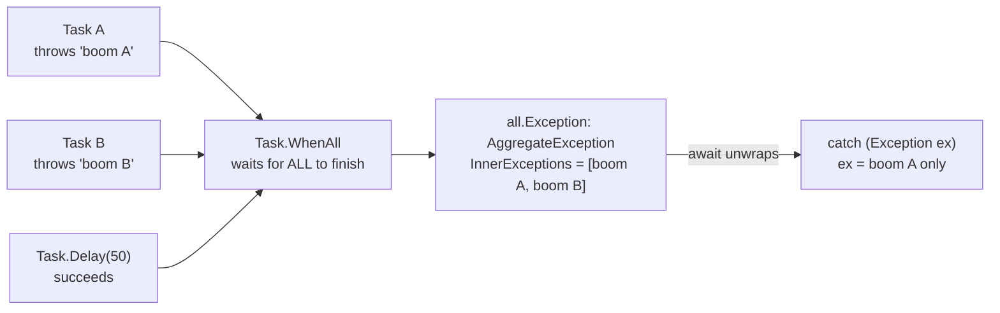

### Key points

- `WhenAll` waits until **every** task has finished, even after one has failed. It does not stop early.
- `await` throws only the **first** inner exception, to keep `catch` blocks simple.
- To log every failure, read `task.Exception.InnerExceptions` from the `WhenAll` task.
- `.Wait()` / `.Result` throw the full `AggregateException`. `await` throws the first inner exception.
- **`async void`**: the caller gets no Task, so its exceptions cannot be caught and can crash the process. Use it only for event handlers.

### Sample output

```
  [T 12 pool] 'await' rethrows only the FIRST exception: boom A
  [T 12 pool] all.Exception.InnerExceptions holds every one: [boom A, boom B]  <- log these, not just the first
```

---

## 9. `starvation`: Thread-pool starvation

> **Interview question:** *"The API is slow under load but CPU is low. What is going on?"*

### What the code does

1. The demo body runs with `TaskCreationOptions.LongRunning`, which gives it **its own thread** (`own` in the output). That way it can measure the pool from outside without using a pool thread itself.
2. It reads the pool's minimum thread count (= number of CPU cores, e.g. 12).
3. **Blocking phase:** it queues `3 × min` tasks that call `Thread.Sleep(3000)`. Each one **holds a pool thread** for 3 s.
4. It times a trivial `Task.Run(() => {})`. This empty task has to **queue behind them**, because no thread is free and the pool adds new threads slowly (~1-2 per second).
5. **Async phase:** the same number of tasks, but they use `await Task.Delay(3000)`. While waiting they **hold no thread**, so the trivial task runs immediately.

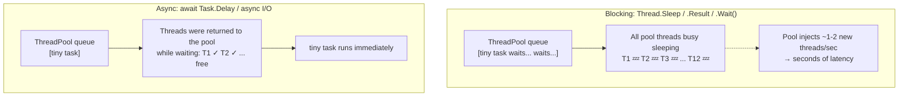

### Sample output

```
  [T 20 own ] Pool starts with ~12 threads. Queuing 36 tasks that BLOCK a thread for 3s (Thread.Sleep)...
  [T 20 own ] A trivial Task.Run waited 5812 ms for a free thread  <- STARVATION (pool injects only ~1-2 threads/second)
  [T 20 own ] Now the same load written with ASYNC waits (await Task.Delay) instead of blocking...
  [T 20 own ] A trivial Task.Run waited 0 ms  <- threads are released while waiting, so the pool stays healthy
```

**About 5.8 seconds for an empty task** versus **0 ms**. The CPU was idle the whole time, because the threads were only sleeping.

### How it looks in production

- High latency, **low CPU**, and the thread count slowly climbing (watch it with `dotnet-counters monitor`, counter `threadpool-thread-count` and `threadpool-queue-length`).
- Causes: `.Result`, `.Wait()`, `Thread.Sleep`, synchronous I/O, or `lock` held over slow calls inside request handlers.
- Fix: **async end-to-end**. Raising `ThreadPool.SetMinThreads` only treats the symptom.

This is the ASP.NET Core relative of demo 7: there is no deadlock, but blocking still hurts throughput.

---

## Cheat sheet

| Problem | Wrong | Right |
|---|---|---|
| Run work in the background | `new Thread(...)` for short jobs | `Task.Run` (CPU) / `async` method (I/O) |
| Many I/O calls | `foreach { await ... }` when the calls are independent | `await Task.WhenAll(...)` |
| CPU-heavy loop | `Task.WhenAll` + `Task.Run` for every item | `Parallel.For` / PLINQ |
| Shared counter | `count++` | `Interlocked.Increment(ref count)` |
| Shared complex state | no synchronisation | `lock`, or a `Concurrent*` collection |
| Expensive cache factory | `dict.GetOrAdd(key, Expensive)` | `dict.GetOrAdd(key, _ => new Lazy<T>(Expensive)).Value` |
| Limit parallel calls | start everything at once | `SemaphoreSlim` / `Parallel.ForEachAsync(MaxDegreeOfParallelism)` |
| Lock across `await` | `lock` (won't compile) | `SemaphoreSlim(1)` + `WaitAsync` |
| Cancel work | `Thread.Abort` (not supported) | pass a `CancellationToken` all the way down |
| Timeout | `WaitAsync(timeout)` only | `CancellationTokenSource(timeout)` + token |
| Fast producer, slow consumer | unbounded queue | bounded `Channel<T>` with `FullMode.Wait` |
| Calling async from sync | `.Result` / `.Wait()` | `await`, async all the way |
| Library code awaits | plain `await` | `await ...ConfigureAwait(false)` |
| Multiple task failures | read only `ex` | read `whenAllTask.Exception.InnerExceptions` |
| Fire-and-forget method | `async void` | `async Task` (event handlers are the exception) |

### Async vocabulary

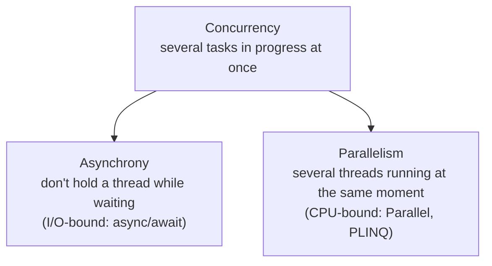
